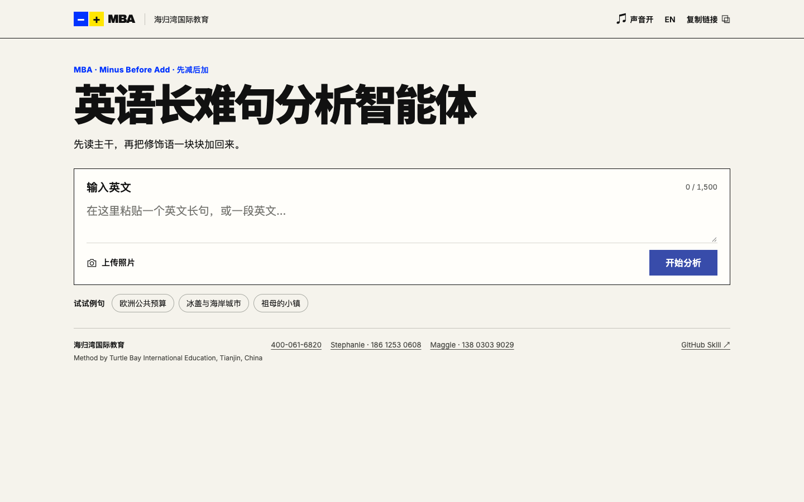

# 英语长难句分析智能体 · English Long Sentence Analyzer

**[打开网站 · Open the analyzer](https://sentence.turtlebayedu.com)**　|　[GitHub 技能主页 · Installable skill](https://github.com/shelfom/english-long-sentence-agent)　|　[下载技能包 · Download ZIP](https://github.com/shelfom/english-long-sentence-agent/releases/latest/download/mba-long-sentences.zip)

输入英文后按 Enter 开始，Shift+Enter 换行。也可以上传照片，校对识别结果后开始。换词时保留标点切出的大块。减法时逐处加括号，每切一块就看它的中文；修饰语淡去后，原处留下英文骨架和中文。读懂后按 Enter 或点大按钮，逐块加回。每一步讲完，底部的大按钮会闪动，提醒你进入下一步。从第 7 步起原句速读自动连播到结尾，同样配有逐块中文。讲完后按钮会写明“讲完了”，可以回看，也可以换一个句子。分析还在进行时，画面上总有动静：已拆出的分块连同中文先行出现，阅读标记在余下的句子上移动。也可暂停、调速或回看某一步。

Paste up to 1,500 characters of English or upload a JPG, PNG or HEIC photo up to 8 MB. Correct the extracted text before analyzing. Use the sentence picker for paragraphs. The three worked examples are available instantly and use no model tokens.



## 教学方法 · Method

MBA means **Minus Before Add（先减后加）**. Keep punctuation blocks intact while swapping advanced words. During subtraction, each phrase or clause separates from its block alongside its Chinese meaning. The smallest grammatical skeleton emerges in place with its own Chinese translation. Click the named button or press Enter to start rebuilding. Each addition appears with its translation, followed by the meaning of the complete sentence. Words then return to their original form one by one. When a step is over the main button blinks on and off, twice a second, until it is pressed. From step 7 the faster replay of the original runs by itself to the end, still pairing English with Chinese. The button then says the sentence is done and offers a new sentence; all numbered stages remain available for review. While the analysis is still running something always moves: chunks already found appear with their Chinese and a reading mark travels through the rest of the sentence. The published skill (2.2.0) has dropped step 12 as well. The analysis prompt still uses the skill text pinned above, except that the worked example's replacements are now everyday words (see below): in a side-by-side run the 2.2.0 wording gave fewer usable first answers (34 against 38 of 40), so sync that copy only with a measured run of `scripts/probe.ts`.

教学规则、信号词表和标准例句来自[技能仓库](https://github.com/shelfom/english-long-sentence-agent/tree/40d0101d047f09684c157c21b6d2ab8474ffe196/skills/mba-long-sentences)。构建程序逐字读取本仓库中对应的三个文件，另加结构化数据格式要求。更新技能时请同步这三个源文件。技能 2.2.0 已去掉第 12 步；本站的分析提示词暂时仍用上面这一版文本（标准例句里的换词已改成日常小词，见下文），因为换成 2.2.0 的文本后，同时对比的首答可用率从 38/40 降到 34/40。同步之前请先用 `scripts/probe.ts` 实测。

## 本地运行 · Run locally

Install Node.js 24 and run the following commands.

```sh
npm ci
npm run build
npm start
```

The homepage and worked examples run without credentials. For custom text or OCR, set `ARK_API_KEY` in the server environment. Set `CACHE_SECRET` to a random secret to enable encrypted caching and `STATS_TOKEN` to a different random secret for aggregate statistics. Keep secrets on the server. `DATA_DIR` selects the SQLite directory. `DAILY_TOKEN_BUDGET` defaults to 1,250,000 combined input and output tokens. Reservations protect against concurrent requests spending the same budget.

生产环境使用 Next.js、TypeScript、Tailwind、SQLite 和火山方舟 Doubao Seed 2.0 Pro。Caddy 负责 HTTPS，并覆盖客户端地址头。应用绑定本机回环地址，systemd 以 tbapps 身份运行。服务和站点配置见 [deploy](deploy/)。

Photos are processed in memory. The app stores aggregate daily token counts and encrypted, sentence-keyed cache entries with seven-day validity. Rate limits use an in-memory keyed hash of the address. A sentence costs no model tokens when an eligible cached answer is returned. The app sends submitted text and images to Volcengine Ark for inference.

## 从模型回答到一堂课 · From a model answer to a lesson

模型对长难句的拆分常常思路正确而格式不严：分块抄了原词、宾语从句标成了从句主干、修饰对象写成了一句描述、骨架用错了词表。`lib/repair.ts` 把这样的回答重建为严格的课程数据；确实定不下来的地方，再把模型自己的回答和具体问题一并发回，请它只改这些。一句话最多调用三次模型；模型两次给出同样的错误就不再问第三次，直接用最近一次可用的回答成课。

A model's breakdown of a hard sentence is usually sound in substance and loose in form. `lib/generate.ts` first reads the answer strictly. If that fails, `lib/repair.ts` rebuilds it: rows may quote either wording, swaps may come out of order, an object clause on the main line counts as main skeleton, a core may claim rows the answer bracketed, a modifier of a whole clause needs no single head word (`clauseLevel`), and a row that contains the rows listed after it is divided around them, with one small request for the Chinese of its parts. Whatever stays unsettled goes back to the model with its own answer and the exact points to correct, for at most three calls in all; if the model raises the same objection twice, the third call is skipped. The newest usable answer is then settled by fitting its rows to the sentence as closely as they allow. Only when no answer follows the sentence at all does the learner get the skeleton and translation alone.

A failure before anything has reached the learner, such as a dropped connection to the model, is tried once more by itself; a failure that is reported writes its cause to the server log (`[analyze] failed:`), without the sentence.

To see why a sentence is rejected, run the same loop from the command line. It prints one line per sentence and writes every model answer as JSON, which `tests/fixtures/model-answers.json` was drawn from.

```sh
ARK_API_KEY=... node scripts/probe.ts sentences.json 4 > answers.json
```

## 换词要多简单 · How simple a replacement must be

换词只换真正的大词，换上去的必须是初学者已经认识的日常小词（目标 A2）。模型换上去的词如果和原词差不多难，系统会再单独问一次更简单的说法；还是不够简单，这一处就不换，原词照旧留在句子里。

The contract in `lib/analysis.ts` asks the model for one to three everyday words (CEFR A2) per replacement and tells it to leave a term alone when no such wording fits. `lib/easy-words.ts` then judges every replacement against two hand-kept lists, everyday words (about A1–A2) and fairly common ones (about B1); they are an editorial estimate, not a dictionary-certified level. A replacement is shown only when the words it removes include a word on neither list (or form an expression of several words, which may be an idiom) and every word it brings in is on a list, in at most three words more than the original. *resisted → said no to* is kept; *fell → dropped* and a mere respelling are dropped, because the original needs no replacing. Where a big word was replaced with another big word (*resisted → opposed*, *rivals → competitors*), one small request (`easer` in `lib/generate.ts`) asks the model for everyday words for exactly those terms; the live preview waits for that answer, so the wording never changes on screen. If the second wording is still hard, the original stands. The answer's rows, cores, heads and table may still quote the dropped wording; `lib/repair.ts` follows them and puts the sentence's own words back. Add a word to the lists when a good replacement is dropped for a word every learner knows. Kept lessons are keyed by fingerprints of the lists and of the model's instructions, so a change to either makes them again.

## 测试 · Tests

```sh
npm test
npm start -- -H 127.0.0.1 -p 5196
# In another terminal, with Chromium installed
npm run qa:browser
```

Set `CHROME_PATH` to a Chromium executable and `TEST_BASE_URL` to test another instance. The browser test checks automatic cues within each stage, the steps that wait for a press and the automatic run from step 7, the live view shown while the analysis runs, the finish, word boundaries and overlaps, screenshots for all eleven steps and the vocabulary restoration at phone and desktop sizes, reduced motion, copying and printing.

海归湾国际教育 · 400-061-6820 · Stephanie 186 1253 0608 · Maggie 138 0303 9029

Method by Turtle Bay International Education, Tianjin, China · 海归湾国际教育
